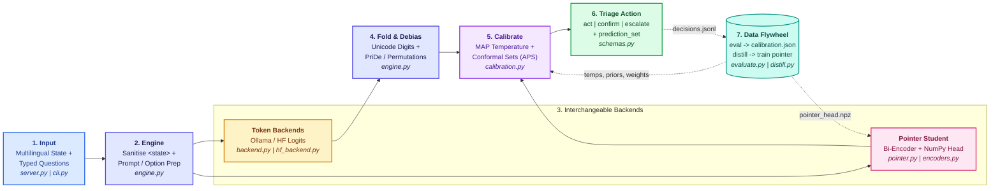
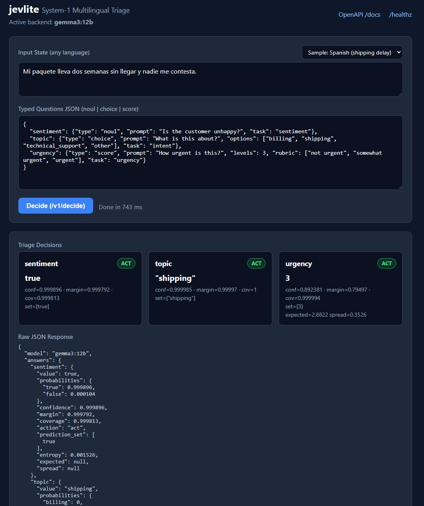

# jevlite

A small, local, JEV-style **System One** decision layer for multilingual text triage, running on [Ollama](https://ollama.com) and local Hugging Face causal LMs as distilled non-generative pointer head.

Ask multilingual questions to JevLite and get prediction sets out with confidence score. 

---

## Table of Contents

- [1: Overview & Business Value](#1-overview--business-value)
  - [1.1 Summary](#11-summary)
  - [1.2 Practical Use Cases Across Industries](#12-practical-use-cases-across-industries)
  - [1.3 What It Is (and Isn't)](#13-what-it-is-and-isnt)
- [2: System Architecture & Codebase Map](#2-system-architecture--codebase-map)
  - [2.1 Architecture](#21-visual-architecture)
  - [2.2 End-to-End Decision Flow](#22-end-to-end-decision-flow)
  - [2.3 Module Walkthrough](#23-module-walkthrough)
- [3: Getting Started & Operations](#3-getting-started--operations)
  - [3.1 Quickstart](#31-quickstart)
  - [3.2 CLI Reference](#32-cli-reference)
  - [3.3 HTTP API, Swagger Docs & Configuration](#33-http-api-swagger-docs--configuration)
  - [3.4 Offline & Air-Gapped Deployments](#34-offline--air-gapped-deployments)
- [4: Core Primitives, Multilingual & Security Design](#4-core-primitives-multilingual--security-design)
  - [4.1 Question Primitives (`noul`, `choice`, `score`)](#41-question-primitives-noul-choice-score)
  - [4.2 Multilingual & Security Design Choices](#42-multilingual--security-design-choices)
- [5: Calibration & Conformal Risk Control](#5-calibration--conformal-risk-control)
  - [5.1 How Calibration & Conformal Routing Work](#51-how-calibration--conformal-routing-work)
  - [5.2 Reading an Evaluation Run](#52-reading-an-evaluation-run)
- [6: Going Non-Generative (Distillation & Pointer Student)](#6-going-non-generative-distillation--pointer-student)
  - [6.1 Backend Comparison](#61-backend-comparison)
  - [6.2 Distilling & Training the Pointer Model](#62-distilling--training-the-pointer-model)
  - [6.3 Continuous Improvement Flywheel](#63-continuous-improvement-flywheel)
- [7: Testing, Limits & Research References](#7-testing-limits--research-references)
  - [7.1 Test Suite Status](#71-test-suite-status)
  - [7.2 Known Limits](#72-known-limits)
  - [7.3 Research References](#73-research-references)
  - [7.4 License](#74-license)

---

## 1: Overview & Business Value

### 1.1 Summary

Organizations receive messages, tickets, reports, and alerts in dozens of languages every day. Traditional AI chatbots are slow, expensive, and prone to "hallucinating" off-script answers, while translation pipelines lose urgency and cultural nuance.

**jevlite** turns local AI into a fast, predictable **triage switchboard**:

- **Reads any language natively**: Evaluates messages in Spanish, Arabic, Japanese, Hindi, Swahili, and more without translating them first.
- **Zero hallucinated text**: Instead of writing essays, `jevlite` only answers structured business questions—**Yes/No** (*"Is the customer unhappy?"*), **Multiple Choice** (*"Billing, Shipping, or Tech Support?"*), and **1–N Severity Ratings** (*"How urgent is this?"*).
- **Knows when to ask a human**: Every answer comes with an honest, statistically calibrated confidence score and routes automatically into one of three buckets:
  - **`act`** — High certainty: handle automatically right away.
  - **`confirm`** — Medium certainty: show a human reviewer the top 2 likely options for a 1-click decision.
  - **`escalate`** — Ambiguous or unusual: send straight to a specialist.
- **Private, fast, and gets cheaper over time**: Runs 100% locally (including offline/air-gapped environments) so sensitive data never leaves your servers, and can train a tiny CPU-friendly model from everyday decisions to cut compute costs even further.

### 1.2 Practical Use Cases Across Industries

Beyond customer support, `jevlite` fits any workflow requiring **fast, private, multilingual gating or classification** without generative latency or hallucination risk:

| Domain | Example Inputs (`state`) | Typed Questions (`noul` / `choice` / `score`) | Why `jevlite` Fits |
|---|---|---|---|
| **AI Agent Router & Guardrails** | User prompts, RAG queries | `noul`: PII / jailbreak check<br/>`choice`: tool or index selection<br/>`score`: complexity `1..5` (route easy queries to small models) | Millisecond System-1 gate in front of expensive System-2 LLMs; cannot generate off-policy text. |
| **Trust, Safety & Marketplaces** | Cross-border product listings, reviews, live chat | `noul`: prohibited item?<br/>`choice`: `scam` / `hate_speech` / `spam` / `safe`<br/>`score`: harm severity `1..5` | Conformal `act` auto-clears safe traffic within error bound $\alpha$; `confirm` gives moderators a 2-option shortlist. |
| **Healthcare & Pharmacovigilance** | Multilingual patient portal notes, adverse drug event reports | `noul`: adverse reaction reported?<br/>`choice`: clinical specialty routing<br/>`score`: acuity `1..5` | Runs 100% air-gapped (PHI stays on-premise); ordinal `score` spread prevents under-triaging high-acuity cases. |
| **Financial Compliance & AML** | Local-language global news, wire memos, surveillance | `noul`: fraud / sanctions allegation?<br/>`choice`: `sanctions` / `aml` / `insolvency` / `unrelated`<br/>`score`: materiality `1..5` | Writes deterministic probabilities, `coverage`, and `prediction_set` to `decisions.jsonl` for audit trails. |
| **Cybersecurity & Threat Intel** | Global employee-reported phishing emails, OSINT feeds | `noul`: credential or wire request?<br/>`choice`: `phish` / `bec_fraud` / `malware` / `benign`<br/>`score`: SOC priority `1..5` | `<state>` delimiter sanitisation blocks prompt injection hidden inside malicious emails. |
| **Global Supply Chain & Customs** | Supplier emails, bills of lading, factory logs (ZH/VI/ES/DE/TR) | `noul`: shipment delay or shortage?<br/>`choice`: `customs` / `raw_material` / `defect` / `weather`<br/>`score`: line-stoppage risk `1..5` | Evaluates domain jargon in its native language without brittle machine-translation pipelines. |
| **Crisis Response & Civic 311** | Disaster SMS/WhatsApp reports, municipal intake | `choice`: `medical` / `rescue` / `water` / `power_outage`<br/>`score`: life-safety urgency `1..5` | Runs offline on field laptops; Mondrian per-language calibration protects minority-language speakers. |
| **Customer Support Operations** | Tickets, emails, app store reviews | `noul`: unhappy customer?<br/>`choice`: `billing` / `shipping` / `tech_support`<br/>`score`: urgency `1..3` | Instant triage across 100+ languages; distills into a zero-GPU NumPy pointer model. |

### 1.3 What It Is (and Isn't)

`jevlite` *approximates* a System One model by reading the next-token distribution of an instruct LLM (or scoring options directly with a trained pointer head) and restricting outputs to a fixed answer alphabet. Calibration and conformal prediction keep confidence and routing decisions statistically grounded.

---

<details>
<summary><h2 id="2-system-architecture--codebase-map" style="display:inline">2: System Architecture &amp; Codebase Map</h2></summary>

### 2.1 Visual Architecture



### 2.2 End-to-End Decision Flow

```
state + typed questions ──► sanitised <state> prompt ──► first-token logprobs / pointer logits
        ──► Unicode + script-digit folding (logaddexp) ──► PriDe 1-pass or parallel permutation debiasing
        ──► MAP temperature scaling ──► Split Conformal APS + ordinal spread guard
        ──► value + probs + prediction_set + confidence + entropy + action
```

1. **Input**: You submit a `state` (string or JSON object, in any language), an optional `lang` tag, and one or more typed questions (`noul`, `choice`, `score`).
2. **Sanitise & Cache**: Untrusted `state` text is sanitised against `<state>` delimiter breakout and placed first in the prompt so multi-question requests share the LLM's KV prefix cache.
3. **Fold & Coverage**: Candidate tokens (`"Yes"`, `" yes"`, `"Yes."`, full-width `"Ａ"`, Arabic-Indic `"٣"`, Devanagari `"२"`) are normalised, merged via `logaddexp`, and summed per valid symbol while recording raw `coverage` as an out-of-distribution guard.
4. **Debias**: For `choice`, position bias is removed either in **1 pass** via a calibrated **PriDe** option-letter prior (`permutations=1`) or across $k$ concurrent option rotations (`permutations=k`).
5. **Calibrate & Route**: A per-task **MAP-regularised temperature** rescales probabilities, **Split Conformal Prediction (APS)** builds a `prediction_set` at target error rate $\alpha$, and ordinal `spread` ($\sigma$) guards `score` rubrics.
6. **Structured Output**: Returns `value`, `probabilities`, `prediction_set`, `confidence`, `margin`, `coverage`, `entropy`, optional `expected`/`spread` (`score`), and `action` (`act` / `confirm` / `escalate`).

### 2.3 Module Walkthrough

| Module | Role in the Pipeline |
|---|---|
| [jevlite/schemas.py](jevlite/schemas.py) | Pydantic v2 request/response contracts (`Noul`, `Choice`, `Score`, `DecideRequest`, `Answer` with `prediction_set`, `entropy`, `expected`, `spread`). |
| [jevlite/engine.py](jevlite/engine.py) | Prompt construction with `<state>` tag-breakout sanitisation, Unicode/script-digit folding, parallel cyclic permutations, PriDe 1-pass debiasing, ordinal `Score` routing, and Split Conformal routing. |
| [jevlite/calibration.py](jevlite/calibration.py) | MAP-regularised temperature scaling, Split Conformal Adaptive Prediction Sets (APS) + Mondrian language quantiles, PriDe prior estimation, ECE, Brier, and Ranked Probability Score (`rps`). |
| [jevlite/backend.py](jevlite/backend.py) | `OllamaBackend` (`num_predict=1`, `top_logprobs=20`, `logaddexp` subword merging without double-counting) and `StubBackend` for deterministic tests. |
| [jevlite/hf_backend.py](jevlite/hf_backend.py) | Local Hugging Face `AutoModelForCausalLM` single forward pass over last-token logits (never calls `generate()`). |
| [jevlite/encoders.py](jevlite/encoders.py) | `HashEncoder` (char n-gram test encoder) and `HFEncoder` with asymmetric query/candidate prefixes (e.g. `"query: "` vs `"passage: "` for multilingual-E5). |
| [jevlite/pointer.py](jevlite/pointer.py) | Non-generative NumPy pointer head (`~0.7M` params at `d=768`), analytic gradients, coverage-weighted loss, unimodal ordinal smoothing, and soft-label preservation. |
| [jevlite/distill.py](jevlite/distill.py) | Teacher-to-student distillation recording calibrated `soft` probabilities, `teacher_cov`, and `teacher_entropy` for active learning. |
| [jevlite/evaluate.py](jevlite/evaluate.py) | Task-stratified 50/50 split fitting PriDe priors, MAP temperatures, and conformal quantiles while reporting per-language accuracy, ECE, Brier, `score_rps`, and risk-coverage. |
| [jevlite/server.py](jevlite/server.py) | FastAPI `/v1/decide` and `/healthz` with lifespan cleanup, interactive triage console, and non-blocking async JSONL audit logging. |
| [jevlite/cli.py](jevlite/cli.py) | Unified CLI (`check`, `decide`, `eval`, `distill`, `train`, `openapi`). |

</details>

---

<details>
<summary><h2 id="3-getting-started--operations" style="display:inline">3: Getting Started &amp; Operations</h2></summary>

### 3.1 Quickstart

```bash
pip install fastapi httpx pydantic uvicorn numpy pytest
ollama pull gemma3:12b              # or gemma:latest / gemma4:latest
export JEV_MODEL=gemma3:12b

python -m jevlite.cli check         # verifies Ollama returns logprobs; probes en/ja/ar
python -m jevlite.cli eval --data data/multilingual_sample.jsonl --out calibration.json
uvicorn jevlite.server:app --port 8000
```

Send a multilingual triage request:

```bash
curl -s localhost:8000/v1/decide -H 'content-type: application/json' -d '{
  "state": "Mi paquete lleva dos semanas sin llegar y nadie me contesta.",
  "lang": "es",
  "permutations": 1,
  "questions": {
    "sentiment": {"type": "noul", "prompt": "Is the customer unhappy?", "task": "sentiment"},
    "topic": {"type": "choice", "prompt": "What is this about?",
              "options": ["billing", "shipping", "technical_support", "other"], "task": "intent"},
    "urgency": {"type": "score", "prompt": "How urgent is this?", "levels": 3,
                "rubric": ["not urgent", "somewhat urgent", "urgent"], "task": "urgency"}
  }
}'
```

### 3.2 CLI Reference

```bash
python -m jevlite.cli check                                                           # probe backend, check logprobs/coverage
python -m jevlite.cli decide '{"state": "...", "questions": {...}}'                   # one-off decision, prints JSON
python -m jevlite.cli eval --data FILE.jsonl [--alpha 0.10] [--out calibration.json]  # fit PriDe + MAP temps + conformal APS
python -m jevlite.cli distill --unlabeled raw.jsonl --out soft.jsonl [--min-coverage 0.50]
python -m jevlite.cli train --data soft.jsonl --out pointer_head.npz                  # train the pointer head
python -m jevlite.cli openapi [--out-dir docs]                                        # export static openapi.json + swagger.html
```

Global backend flags for any subcommand (precedence: `pointer > hf > Ollama`):
- `--pointer FILE.npz`
- `--hf-model PATH`
- `--model NAME` / `--host URL`

### 3.3 HTTP API, Swagger Docs & Configuration

```bash
uvicorn jevlite.server:app --port 8000 --reload
```

- `GET /` — Built-in interactive browser triage console ([jevlite — Multilingual Triage Console](http://127.0.0.1:8000/)) with multilingual presets and live `/v1/decide` cards (returns service metadata JSON when `Accept: application/json` is sent).
- `GET /docs` — Live interactive Swagger UI (`http://127.0.0.1:8000/docs`).
  - **Offline / Static Swagger Artifacts**: [docs/swagger.html](docs/swagger.html) (standalone Swagger UI page with embedded spec) and [docs/openapi.json](docs/openapi.json) (OpenAPI 3.1 schema, regenerated anytime via `python -m jevlite.cli openapi`).
- `POST /v1/decide` — Accepts a `DecideRequest` (`state`, `questions`, optional `lang`, optional `permutations`) and returns a `DecideResponse` with one `Answer` per question. Every request/response pair is appended asynchronously off the event loop to `decisions.jsonl`.
- `GET /healthz` — Returns `{"ok": true, "model": "<backend name>"}` for liveness probes.

#### Interactive Multilingual Triage Console (`http://127.0.0.1:8000/`)

[](http://127.0.0.1:8000/)

#### Interactive Swagger / OpenAPI Specification (`/docs` & `docs/swagger.html`)

[](docs/swagger.html)

| Environment Variable | Default | Purpose |
|---|---|---|
| `JEV_POINTER` | *(unset)* | Path to trained `.npz` pointer head (highest backend precedence). |
| `JEV_HF_MODEL` | *(unset)* | Model ID or local directory for logits-only Hugging Face causal LM. |
| `JEV_MODEL` / `OLLAMA_HOST` | `gemma3:12b` / `http://localhost:11434` | Ollama model tag and server URL. |
| `JEV_CALIBRATION` | `calibration.json` | Calibration file containing temperatures, conformal quantiles, and PriDe priors. |
| `JEV_ACT` / `JEV_CONFIRM` | `0.85` / `0.60` | Fallback confidence thresholds when conformal quantiles are not loaded. |
| `JEV_MAX_CONFIRM_SET` | `2` | Maximum prediction-set cardinality routed to `confirm` before escalating. |
| `JEV_LOG` | `decisions.jsonl` | Output path for audit and active-learning logs. |

### 3.4 Offline & Air-Gapped Deployments

Prepare dependencies and model snapshots on a connected machine, then transfer them into the isolated environment:

```bash
python -m pip download -r requirements.txt -d wheelhouse
python -m pip download torch transformers -d wheelhouse  # optional Hugging Face support
python -m pip install --no-index --find-links=wheelhouse -r requirements.txt torch transformers
```

Transfer the complete Hugging Face model snapshot (config, tokenizer files, weight shards) and set `HF_HUB_OFFLINE=1` (`$env:HF_HUB_OFFLINE = "1"` on PowerShell) so loaders strictly use local files:

```bash
export HF_HUB_OFFLINE=1
python -m jevlite.cli --hf-model /models/my-causal-lm check
```

> **Note on Gemma tags:** First-generation `gemma:latest` (7B) is mostly English-focused. Prefer `gemma3` (`gemma3:4b`, `gemma3:12b`) or `gemma4:latest` for stronger multilingual coverage. Models without a thinking mode reject Ollama's `think` flag; `OllamaBackend` retries without it automatically.

</details>

---

<details>
<summary><h2 id="4-core-primitives-multilingual--security-design" style="display:inline">4: Core Primitives, Multilingual &amp; Security Design</h2></summary>

### 4.1 Question Primitives (`noul`, `choice`, `score`)

`jevlite` models every triage decision through three typed question primitives—**`noul`**, **`choice`**, and **`score`**—each returning a structured `Answer` with shared uncertainty and routing fields (`confidence`, `margin`, `coverage`, `entropy`, and `action`: `"act"` | `"confirm"` | `"escalate"`):

- **`noul` (Binary Yes/No)**: Evaluates a boolean condition and returns a `bool` winner (`value: true | false`), calibrated probabilities keyed as `{"true": p, "false": 1 - p}`, and a conformal `prediction_set` of `list[bool]` (e.g., `[true]`).
- **`choice` (Categorical $1\text{-of-}N$, $2..26$ options)**: Picks the best-matching label from your option list and returns the winning option string (`value: str`), a probability dictionary keyed by your exact option names, and a narrowed `prediction_set` of `list[str]` (e.g., `["shipping", "billing"]`) for 1-click human confirmation.
- **`score` (Ordered $1..N$ Rubric, $2..9$ levels)**: Rates severity, priority, or quality along an ordered scale (with optional rubric descriptions) and returns the winning integer level (`value: int`), probabilities keyed `"1"` through `"N"`, a `prediction_set` of `list[int]`, plus continuous ordinal statistics: `expected` ($\mathbb{E}[Y]$) for fine-grained queue sorting and `spread` ($\sigma$) to distinguish tight consensus on adjacent levels from polarized uncertainty.

| Question Type | Purpose | `value` (Winner) | `probabilities` Keys | `prediction_set` | Extra Fields |
|---|---|---|---|---|---|
| **`noul`** | Binary Yes / No | `bool` (`true` / `false`) | `{"true": p, "false": 1-p}` | `list[bool]` (e.g. `[true]`) | `expected: null`, `spread: null` |
| **`choice`** | Pick 1 of $N$ options ($2..26$) | `str` (winning option text) | `{"billing": p1, "shipping": p2, ...}` | `list[str]` (e.g. `["billing", "shipping"]`) | `expected: null`, `spread: null` |
| **`score`** | Ordered $1..N$ rubric ($2..9$) | `int` (winning level `1..N`) | `{"1": p1, "2": p2, ..., "N": pN}` | `list[int]` (e.g. `[2, 3]`) | `expected` ($\mathbb{E}[Y]$), `spread` ($\sigma$) |

### 4.2 Multilingual & Security Design Choices

- **Language-neutral answer alphabet**: The model emits `A`, `2`, or `Yes`, never a word in the input language.
- **English instructions, original-language state**: Input text is never translated, avoiding translation latency and lost nuance.
- **Unicode, script-digit & punctuation folding**: Candidate tokens are NFKC-normalised, stripped of punctuation (`"A."`, `"Yes,"`), case-folded, and non-Latin Unicode decimal digits (Arabic-Indic `١..٩`, Devanagari `१..९`, full-width `１..９`) map to ASCII `0..9`. Colliding subword tokens merge via `logaddexp`.
- **Prompt-injection isolation**: Raw `<state>` / `</state>` tags inside untrusted user input are escaped before prompt construction, blocking delimiter breakout.
- **1-pass PriDe debiasing & concurrent permutations**: `eval` estimates empirical option-letter priors (**PriDe**) so `permutations: 1` cancels position bias at $1\times$ cost; when `permutations: k` ($k > 1$) is requested, evenly strided rotations execute concurrently via `asyncio.gather`.
- **Coverage guard**: Low probability mass on valid symbols (the model tried to write prose or refuse) forces `escalate` regardless of confidence.
- **KV-prefix caching**: Placing `<state>` first and the question last lets multiple questions about one message reuse the LLM's KV cache.

</details>

---

<details>
<summary><h2 id="5-calibration--conformal-risk-control" style="display:inline">5: Calibration &amp; Conformal Risk Control</h2></summary>

### 5.1 How Calibration & Conformal Routing Work

Raw LLM probabilities are overconfident, and fixed scalar thresholds behave differently on 2-way (`noul`) vs. 20-way (`choice`) questions. `eval` uses a task-stratified 50/50 split to fit **PriDe priors**, **MAP temperatures**, and **Split Conformal Prediction (APS)** quantiles in [calibration.json](calibration.json).

- **MAP-regularised temperature scaling** ([jevlite/calibration.py](jevlite/calibration.py)): Divides log-probabilities by $T$ and minimises $\text{mean\_NLL}(T) + \frac{\lambda}{N}(\log T)^2$ via golden-section search. The log-normal prior prevents small or 100%-accurate splits from collapsing to $T \to 0.2$, while converging to exact MLE as $N$ grows.
- **Split Conformal Prediction / Adaptive Prediction Sets (APS)**: Computes finite-sample quantiles $\hat{q}$ at target error rate $\alpha$ (`--alpha 0.10` $\implies \ge 90\%$ marginal coverage), plus **Mondrian per-language quantiles** (`task|lang`) when a language has $\ge 10$ calibration examples:
  - $|C(x)| = 1 \implies$ `act` (unattended execution within error budget $\alpha$).
  - $1 < |C(x)| \le \text{max\_confirm\_set\_size} \implies$ `confirm` (surfaces the narrowed `prediction_set` for 1-click human review).
  - Wide set or low `coverage` $\implies$ `escalate`.
- **Ordinal-aware `Score` routing & RPS**: `score` questions compute `spread` ($\sqrt{\text{Var}[Y]}$). Tight mass on adjacent levels (e.g. `49% / 51%` on urgency `4` and `5`) routes to `confirm` instead of falsely escalating, whereas bimodal polarization (`42%` on `1` and `58%` on `5`) forces `escalate`. Evaluation also tracks **Ranked Probability Score (`score_rps`)**.

### 5.2 Reading an Evaluation Run

The bundled [data/multilingual_sample.jsonl](data/multilingual_sample.jsonl) (49 examples, 17 languages, 3 tasks, plus edge cases) is a smoke test. For production, label **100+ examples per task** across your target languages and run `eval`:

```text
$ python -m jevlite.cli --model gemma4:latest eval --data data/multilingual_sample.jsonl --out calibration.json
examples: 49  (stratified fit 24 / held-out 25)
mean coverage on valid answer tokens: 0.961

per-language accuracy (uncalibrated argmax, all rows):
   ar  3/3
   de  3/3
   en  9/10
   es  3/4
   ...

fitted temperatures: {'intent': 0.65, 'sentiment': 0.65, 'urgency': 2.45}
fitted PriDe priors: {'intent:4': [0.27, 0.25, 0.24, 0.24]}
conformal quantiles (alpha=0.10): {'intent': 0.92, 'sentiment': 0.94, 'urgency': 0.89}
held-out metrics        before   after
  accuracy              0.792   0.792
  ece                   0.183   0.098
  brier                 0.378   0.254
  mean_conf             0.975   0.891
  score_rps             0.195   0.142
  conformal_cov         0.840   0.920   (mean set size 1.32)
```

How to interpret key metrics:
- **`mean coverage` near `1.0`**: The model stays inside the allowed answer alphabet rather than trying to chat.
- **`ece`, `brier`, and `score_rps` dropping**: Confidence and ordinal probabilities better reflect true empirical accuracy.
- **`conformal_cov` $\ge 1 - \alpha$**: Prediction sets contain the true answer at the requested coverage rate, with compact `mean set size`.

</details>

---

<details>
<summary><h2 id="6-going-non-generative-distillation--pointer-student" style="display:inline">6: Going Non-Generative (Distillation &amp; Pointer Student)</h2></summary>

### 6.1 Backend Comparison

Three backends share the exact same `Engine`, HTTP API, and `Calibration` layer:

| Backend | How It Scores Answers | Generates Tokens? |
|---|---|---|
| **Ollama** (default) | `num_predict=1`, reads `top_logprobs=20` | Samples 1 token |
| **HF Causal LM** (`--hf-model` / `JEV_HF_MODEL`) | Single forward pass, reads last-position logits | No |
| **Pointer Student** (`--pointer` / `JEV_POINTER`) | Frozen bi-encoder + trained NumPy head scores option texts | No (has no vocabulary) |

### 6.2 Distilling & Training the Pointer Model

A frozen multilingual bi-encoder embeds `state`, `prompt`, and each verbalised option using asymmetric prefixes (`"query: "` for state/question, auto `"passage: "` for options on E5 models). A lightweight NumPy head (`~0.7M` parameters at `d=768`, trains on CPU) scores each option directly—no letter labels, zero position bias, and `coverage = 1.0`.

```bash
pip install numpy torch transformers      # torch/transformers only needed for HFEncoder

# 1. Label raw unlabeled data with the LLM teacher (filter by coverage, keep boundary uncertainty)
python -m jevlite.cli distill --unlabeled raw.jsonl --out soft.jsonl --min-coverage 0.50

# 2. Train the pointer head on cached embeddings
python -m jevlite.cli train --data soft.jsonl --out pointer_head.npz \
    --encoder intfloat/multilingual-e5-base --prefix "query: "

# 3. Calibrate on held-out data NOT used for training, then serve
python -m jevlite.cli --pointer pointer_head.npz eval --data heldout.jsonl --out calibration.json
JEV_POINTER=pointer_head.npz uvicorn jevlite.server:app
```

Recommended encoders:
- `intfloat/multilingual-e5-base` (`--prefix "query: "`; `--option-prefix` auto-selects `"passage: "`)
- `BAAI/bge-m3` (`--pooling cls`)
- `xlm-roberta-base`
- `hash` (dependency-free char n-gram encoder for unit tests and pipeline demos only)

### 6.3 Continuous Improvement Flywheel

1. **Verbalised options**: `noul` and `score` candidates include `q.prompt` (`"{prompt} — yes"` / `"{prompt} — no"`) so opposite binary questions never collapse onto a static vector.
2. **Uncertainty-preserving distillation**: Soft teacher distributions are weighted by `teacher_cov` and are never double-smoothed; hard `score` labels use unimodal Laplace smoothing.
3. **Active learning**: Sample high-`entropy` escalations from `decisions.jsonl` for human review, append corrections as hard labels, retrain the pointer head, and keep the LLM as the System-2 fallback for `escalate`.

</details>

---

<details>
<summary><h2 id="7-testing-limits--research-references" style="display:inline">7: Testing, Limits &amp; Research References</h2></summary>

### 7.1 Test Suite Status

All **32 unit tests** in [tests/test_jevlite.py](tests/test_jevlite.py) and [tests/test_pointer.py](tests/test_pointer.py) run offline without Ollama, GPUs, or model downloads:

```bash
PYTEST_DISABLE_PLUGIN_AUTOLOAD=1 python -m pytest -v
```

Covered behaviours include MAP temperature regularisation, Unicode/script-digit folding, `<state>` injection sanitisation, `logaddexp` subword merging, PriDe 1-pass debiasing, Split Conformal APS + Mondrian routing, ordinal `Score` spread & RPS, analytic vs. finite-difference pointer gradients, soft-target preservation, unimodal ordinal smoothing, OpenAPI/Swagger static dereferencing, and opposite-question disambiguation.

### 7.2 Known Limits

- **Ollama multi-question calls**: Token backends issue one request per question (times `permutations` when `permutations > 1`), though shared `<state>` prefixes benefit from KV caching.
- **Ollama `logprobs` requirement**: Requires an Ollama version supporting `logprobs` / `top_logprobs` (`cli check` verifies this).
- **Low-resource language variance**: Very low-resource scripts may exhibit lower `coverage` on small LLMs; always inspect per-language breakdown in `eval` and supply 10+ examples per language to activate Mondrian conformal quantiles.

### 7.3 Research References

Each foundational reference below links to the publication and to the exact modules and functions where the concept is implemented in `jevlite`:

- **Kahneman, D. (2011).** [*Thinking, Fast and Slow*](https://us.macmillan.com/books/9780374533557/thinkingfastandslow/). Farrar, Straus and Giroux.
  - **Concept**: Fast, bounded System-1 intuition that defers hard or anomalous cases to slower System-2 reasoning or human specialists.
  - **Where used in code**: Typed non-generative question primitives (`Noul`, `Choice`, `Score`) and three-tier `action` contract (`act` / `confirm` / `escalate`) in [jevlite/schemas.py](jevlite/schemas.py#L19-L69); single-step next-token distribution readout and `coverage` escalation guard in [jevlite/engine.py](jevlite/engine.py#L179-L268); single forward-pass logit readout in [jevlite/hf_backend.py](jevlite/hf_backend.py#L28-L45); and vocabulary-free option scoring in [jevlite/pointer.py](jevlite/pointer.py#L51-L75).
- **Guo, C., Pleiss, G., Sun, Y., & Weinberger, K. Q. (2017).** [*On Calibration of Modern Neural Networks*](https://arxiv.org/abs/1706.04599) ([ICML / PMLR](https://proceedings.mlr.press/v70/guo17a.html)).
  - **Concept**: Post-hoc temperature scaling ($z / T$) to align predicted confidence with empirical accuracy without altering `argmax` predictions, extended here with a MAP log-normal prior $\frac{\lambda}{N}(\log T)^2$ to prevent $T \to 0$ collapse on small splits.
  - **Where used in code**: `apply_temperature` ([jevlite/calibration.py](jevlite/calibration.py#L34-L39)), MAP-regularised `fit_temperature` ([jevlite/calibration.py](jevlite/calibration.py#L42-L87)), task/type lookup `Calibration.temperature` ([jevlite/calibration.py](jevlite/calibration.py#L266-L269)), offline fitting in `fit` ([jevlite/evaluate.py](jevlite/evaluate.py#L140-L145)), and live inference rescaling in `Engine._answer` ([jevlite/engine.py](jevlite/engine.py#L273-L274)).
- **Romano, Y., Sesia, M., & Candès, E. J. (2020).** [*Classification with Valid and Adaptive Coverage*](https://arxiv.org/abs/2006.02544) ([NeurIPS Proceedings](https://proceedings.neurips.cc/paper/2020/hash/244edd7e85dc81602b7615cd705545f5-Abstract.html)).
  - **Concept**: Adaptive Prediction Sets (APS) that accumulate sorted class probabilities up to a calibrated threshold so prediction set size adapts to per-input difficulty across any number of options $K$.
  - **Where used in code**: Nonconformity scoring `aps_nonconformity` ([jevlite/calibration.py](jevlite/calibration.py#L121-L130)), set builder `prediction_set_indices` ([jevlite/calibration.py](jevlite/calibration.py#L144-L157)), `Answer.prediction_set` ([jevlite/schemas.py](jevlite/schemas.py#L64)), and singleton (`act`) vs. compact subset (`confirm`) routing in `Engine._route` ([jevlite/engine.py](jevlite/engine.py#L256-L263)).
- **Angelopoulos, A. N., & Bates, S. (2023).** [*Conformal Prediction: A Gentle Introduction*](https://arxiv.org/abs/2107.07511) ([Foundations and Trends in Machine Learning](https://doi.org/10.1561/2200000101)).
  - **Concept**: Distribution-free finite-sample Split Conformal quantile $\lceil(n+1)(1-\alpha)\rceil / n$ guaranteeing marginal coverage $\mathbb{P}(Y \in C(X)) \ge 1 - \alpha$, plus Mondrian (group-conditional) calibration across subpopulations.
  - **Where used in code**: Finite-sample quantile `fit_conformal_quantile` ([jevlite/calibration.py](jevlite/calibration.py#L133-L141)), Mondrian language-scoped lookup (`task|lang`) in `Calibration.quantile` ([jevlite/calibration.py](jevlite/calibration.py#L271-L279)), per-task and per-language quantile fitting in `fit` ([jevlite/evaluate.py](jevlite/evaluate.py#L148-L163)), and empirical coverage tracking (`conformal_cov`, `mean_set_size`) in `metrics` ([jevlite/evaluate.py](jevlite/evaluate.py#L99-L117)).
- **Zheng, C., Zhou, H., Meng, F., Zhou, J., & Huang, M. (2024).** [*Large Language Models Are Not Robust Multiple Choice Selectors*](https://arxiv.org/abs/2309.03882) ([ICLR OpenReview](https://openreview.net/forum?id=shr9PXz7T0)).
  - **Concept**: Eliminating LLM option-position bias (`A`/`B`/`C` order preference) either via **PriDe** (1-pass prior estimation and log-space debiasing) or cyclic option-order permutation averaging.
  - **Where used in code**: Geometric-mean position prior `estimate_prior` ([jevlite/calibration.py](jevlite/calibration.py#L91-L106)), single-pass correction `debias_prior` ([jevlite/calibration.py](jevlite/calibration.py#L109-L117)), prior lookup `Calibration.prior` ([jevlite/calibration.py](jevlite/calibration.py#L281-L288)), offline prior fitting in `fit` ([jevlite/evaluate.py](jevlite/evaluate.py#L129-L137)), and 1-pass PriDe + concurrent multi-pass permutation averaging in `Engine.raw_distribution` ([jevlite/engine.py](jevlite/engine.py#L194-L216)).
- **Naeini, M. P., Cooper, G., & Hauskrecht, M. (2015).** [*Obtaining Well Calibrated Probabilities Using Bayesian Binning*](https://ojs.aaai.org/index.php/AAAI/article/view/9602) (AAAI).
  - **Concept**: Expected Calibration Error (ECE)—measuring the weighted gap between predicted confidence and empirical accuracy across confidence bins.
  - **Where used in code**: Binned `ece` calculation ([jevlite/calibration.py](jevlite/calibration.py#L179-L193)) and held-out before/after calibration reporting in `metrics` and `report` ([jevlite/evaluate.py](jevlite/evaluate.py#L109-L195)).

### 7.4 License

[Apache License 2.0](LICENSE)

</details>
